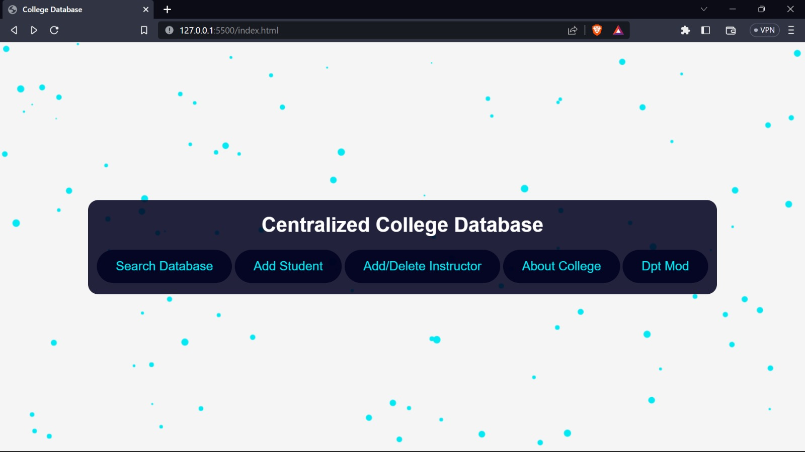

# Centralized College Database

**DBMS Project — MNNIT Allahabad | Semester 5**

## Project Team

1. Manshi Sahu
2. M. Dharshini
3. Khushi Chauhan
4. Mahak Garg

## Overview

The **Centralized College Database** is a database management system project designed to store, organize, and retrieve college student and course information through a centralized database. The project includes a Node.js backend, a MySQL database, and a web-based interface.

## Technology Stack

- **Backend:** Node.js, Express.js
- **Database:** MySQL
- **Frontend:** HTML, CSS, JavaScript
- **Data visualization:** D3.js (for visualizing the college structure)
- **Animations and effects:** anime.js (for particle effects on the main page and login page)

## Project Preview

The following screenshots show the project interface. Keep the image files in the project folder, or update the paths below to match their actual locations.

### 1. Main Page


### 2. Search Database


### 3. Search Results


## Project Abstract

Colleges have multiple academic departments, such as English, Mathematics, History, and Physics. Each department may offer several courses, and an instructor may be qualified to teach more than one course. Similarly, students may enroll in multiple courses.

The Centralized College Database aims to manage this information in one place. It stores student, department, course, instructor, and enrollment details and supports searching for student records by name and admission year. The database design must also account for course scheduling so that a course has an assigned instructor and students are not enrolled in overlapping classes.

## Project Objectives

- Maintain centralized records for students, courses, departments, and instructors.
- Allow authorized administrators to add and manage student records.
- Retrieve current and historical student information for up to five years.
- Search for students by name and year of admission.
- Represent relationships among departments, courses, instructors, and students in a structured relational database.
- Provide a user-friendly web interface connected to the MySQL database.

## Project Problem Statement

Student and academic information can be difficult to maintain when it is spread across separate records. This project proposes a centralized database that allows an administrator to enter, manage, and retrieve student information efficiently.

The system should support multiple departments and courses, allow instructors to teach more than one course, and allow students to enroll in multiple courses. Course scheduling should prevent a student from being assigned to two courses that overlap in time.

## Functional Requirements

### 1. Add Student Records

- The administrator can enter a student's details through a form.
- Student information may include name, age, address, course or enrollment details, and year of admission.
- The system validates the entered information before saving it.
- After submission, the system stores the student record in the MySQL database and provides a success or error message.

### 2. View Current and Historical Student Records

- The administrator can view records for current students and students from previous batches.
- The system supports retrieval of records for up to the previous five years.
- Records can be filtered by admission year or other available fields.

### 3. Search Student Records

- The administrator can search for students by name.
- The administrator can search or filter students by year of admission.
- Search results display matching student details in a readable format.

### 4. Manage Academic Information

- Store and organize department, course, instructor, and student enrollment information.
- Allow one instructor to be associated with multiple courses where appropriate.
- Allow students to enroll in multiple courses.
- Store course schedule information so that overlapping enrollments can be identified or prevented.

### 5. Database Connectivity

- The Node.js/Express backend connects to the MySQL database.
- The application reports connection or query errors appropriately.
- Database operations use validated inputs and parameterized queries.

## Database Design Requirements

The database design should include the following deliverables:

1. **ER diagram:** Show the entities, attributes, relationships, and cardinalities.
2. **Key attributes:** Identify primary keys and foreign keys for each entity.
3. **Non-key attributes:** Identify descriptive attributes that are not keys.
4. **Relational schema:** Convert the ER model into relational tables and define the relationships.
5. **Constraints:** Define appropriate primary-key, foreign-key, uniqueness, and validation constraints.
6. **Scheduling rules:** Define how course times and instructor assignments are represented and how overlapping student schedules are handled.

### Suggested Core Entities

The final entities and attributes should be confirmed in the ER diagram and relational schema. A reasonable starting point is:

- **Student:** student ID, name, age, address, admission year.
- **Department:** department ID, department name.
- **Course:** course ID, course name, duration, department ID.
- **Instructor:** instructor ID, instructor name, department ID.
- **Enrollment:** student ID, course ID, academic year or semester.
- **Teaching Assignment / Course Schedule:** instructor, course, time slot, and relevant academic term.

The exact table structure may be adjusted to match the project's implementation and requirements.

## System Workflow

1. The administrator opens the web application.
2. The administrator enters student details in the relevant form.
3. The frontend sends the submitted data to the Node.js/Express backend.
4. The backend validates the input and executes parameterized SQL queries.
5. MySQL stores or retrieves the requested records.
6. The backend returns the result to the frontend.
7. The frontend displays a confirmation, student details, or an appropriate error message.

## Installation and Setup

### Prerequisites

Install the following software:

- Node.js and npm
- MySQL Server
- MySQL Workbench (optional, for database administration)

### 1. Clone or Download the Project

Open a terminal in the project directory:

```bash
cd path/to/Centralized-College-Database
```

### 2. Install Node.js Dependencies

If the repository contains a `package.json`, run:

```bash
npm install
```

The project dependencies, including Express and the `mysql2` driver used by the server scripts, are listed in `package.json`.

### 3. Configure the Database

1. Start MySQL Server. The configured MySQL account must be allowed to create databases and tables.
2. The `npm start` command creates the `CCD` database (or the database selected by `DB_NAME`) and any missing tables from `DatabaseDesign.sql`.
3. Configure the database connection using environment variables before starting the app. The defaults are `DB_HOST=localhost`, `DB_PORT=3306`, `DB_USER=root`, `DB_PASSWORD=#`, and `DB_NAME=CCD`.
4. Avoid committing real credentials to version control. Set credentials in your shell or another local environment configuration; the application does not load `.env` files automatically.

Example environment variables:

```env
DB_HOST=localhost
DB_PORT=3306
DB_USER=your_mysql_username
DB_PASSWORD=your_mysql_password
DB_NAME=CCD
```

On Windows PowerShell, set the values for the current terminal session, for example:

```powershell
$env:DB_USER = "your_mysql_username"
$env:DB_PASSWORD = "your_mysql_password"
```

### 4. Start the Application

From the project directory, install the dependencies and start all three application servers:

```bash
npm install
npm start
```

The startup script initializes the database before starting the student, search, and instructor services on ports 3000, 4000, and 5000. You can override these ports with `PORT`, `SEARCH_PORT`, and `INSTRUCTOR_PORT`. Open `index.html` in your browser to access the homepage:

```text
index.html
```

To initialize the database without starting the servers, run `npm run db:setup`.

## Security and Data Integrity

- Restrict student-record management to authorized administrators.
- Validate all input on the backend.
- Use parameterized SQL queries to reduce SQL injection risk.
- Store database credentials outside source code.
- Apply appropriate database privileges instead of using an administrative account for normal application access.
- Preserve data integrity with primary keys, foreign keys, and suitable constraints.

## Future Enhancements

- Role-based access for administrators and other authorized users.
- Improved search filters and pagination.
- Export student records to CSV or PDF.
- Reporting by department, course, and admission year.
- More detailed course scheduling and conflict detection.

## Project Deliverables

- ER diagram
- Identification of key and non-key attributes
- Relational schema and database constraints
- MySQL database implementation
- Frontend and backend implementation
- Verified Node.js–MySQL connectivity
- Testing of student entry, search, and historical record retrieval

## Acknowledgements

Developed as a Semester 5 DBMS project at **Motilal Nehru National Institute of Technology Allahabad (MNNIT Allahabad)**.

---

**Project members:** Manshi Sahu, M. Dharshini, Khushi Chauhan, and Mahak Garg.
